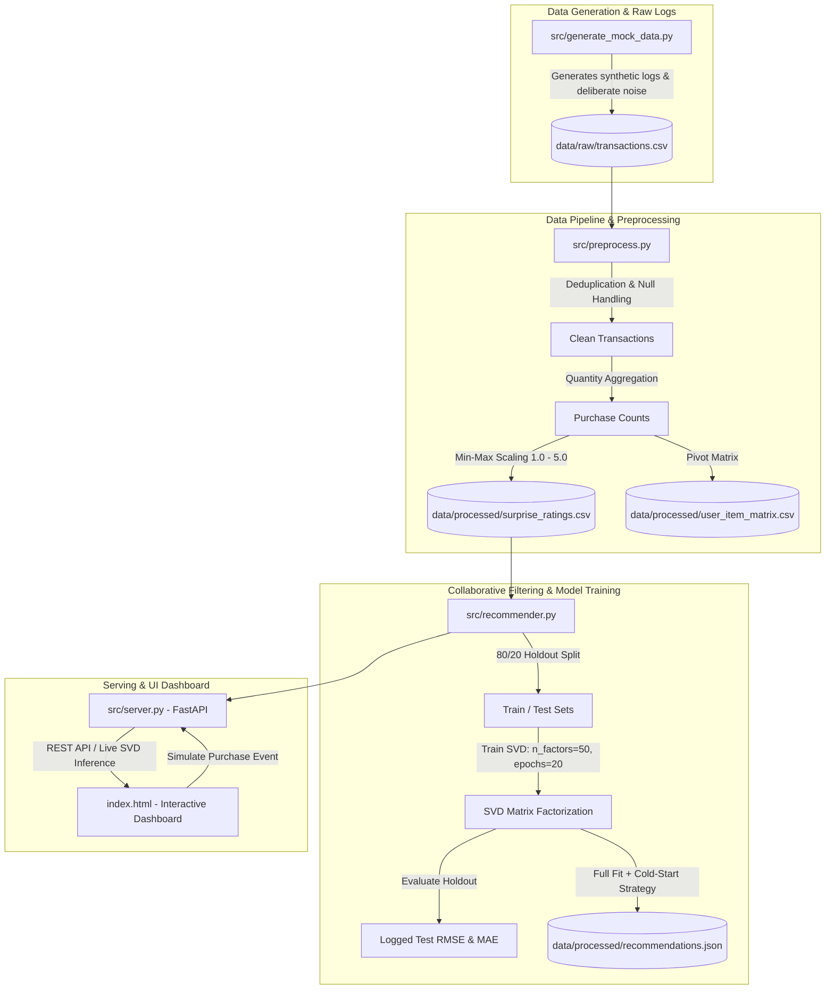

# E-Commerce Customer Purchase Data Preparation & SVD Collaborative Filtering Engine

An end-to-end Machine Learning recommendation system built with **Python**, **Pandas**, **Scikit-Surprise** (`SVD`), **FastAPI**, and an interactive prototype dashboard (`index.html`).

---

## 1. Project Architecture



---

## 2. Directory Structure

```text
python rec project/
│
├── antigravity_multi_agent_project_blueprint.md  # Architectural specification
├── requirements.txt                              # Python library dependencies
├── README.md                                     # Setup & execution guide
├── index.html                                    # Interactive SVD & Data Prep Prototype UI
│
├── data/
│   ├── raw/
│   │   └── transactions.csv                      # Raw e-commerce transaction logs (with noise)
│   └── processed/
│       ├── user_item_matrix.csv                  # Pivoted Customers × Products matrix
│       ├── surprise_ratings.csv                  # Normalized [1.0 - 5.0] interaction triples
│       └── recommendations.json                  # Exported Top-N predictions with AI rationales
│
└── src/
    ├── __init__.py
    ├── generate_mock_data.py                     # Synthetic transaction log generator
    ├── preprocess.py                             # Cleaning, aggregation & scaling pipeline
    ├── recommender.py                            # Scikit-Surprise SVD training & inference
    └── server.py                                 # FastAPI REST backend & live simulator
```

---

## 3. Mathematical Foundations & Algorithms

### A. Implicit Rating Normalization
E-commerce transactions record implicit feedback (purchase quantity $q_{ui}$) rather than explicit $1-5$ star ratings. To prepare data for collaborative filtering, purchase frequencies are aggregated per user-item pair and linearly scaled into $[1.0, 5.0]$:

$$r_{ui} = 1 + 4 \times \frac{\text{count}_{ui} - \min(\text{count})}{\max(\text{count}) - \min(\text{count})}$$

### B. Regularized Matrix Factorization (SVD)
The recommender utilizes Simon Funk's SVD formulation implemented in `scikit-surprise`:

$$\hat{r}_{ui} = \mu + b_u + b_i + q_i^T p_u$$

Where:
- $\mu$: Global average rating
- $b_u$: Customer bias term
- $b_i$: Product item bias term
- $p_u \in \mathbb{R}^{k}$: User latent factor vector ($k=50$)
- $q_i \in \mathbb{R}^{k}$: Item latent factor vector ($k=50$)

**Objective Function with $L_2$ Regularization:**

$$\min \sum_{(u,i) \in R_{\text{train}}} (r_{ui} - \hat{r}_{ui})^2 + \lambda \left( \|p_u\|^2 + \|q_i\|^2 + b_u^2 + b_i^2 \right)$$

Hyperparameters: `n_factors=50`, `n_epochs=20`, `lr_all=0.005`, `reg_all=0.02`.

### C. Cold Start Strategy
When inferring recommendations for an unseen customer (0 interaction history, such as `C004`), traditional matrix factorization throws a prediction error or outputs meaningless default priors. The engine gracefully falls back to a global popularity & quality ranking:

$$\text{Score}_{\text{cold}}(i) = w_1 \cdot \bar{r}_i + w_2 \cdot \log(1 + N_{\text{buyers}}(i))$$

---

## 4. Setup & Installation

### Step 1: Install Dependencies
```bash
pip install -r requirements.txt
```
*(Dependencies: `pandas`, `numpy`, `scikit-learn`, `scikit-surprise`, `fastapi`, `uvicorn`)*

### Step 2: Generate Mock Transactions
```bash
python src/generate_mock_data.py
```
Outputs `data/raw/transactions.csv` containing deliberate noise:
- 40 null IDs (`CustomerID` / `ProductID` missing)
- 35 exact duplicates across `[InvoiceNo, CustomerID, ProductID]`
- Realistic personas: Tech (`C001`), Kitchen (`C002`), Fitness (`C003`), and Cold-Start (`C004`).

### Step 3: Run Data Preprocessing Pipeline
```bash
python src/preprocess.py
```
- Filters nulls & duplicate rows.
- Aggregates quantities into purchase counts.
- Normalizes implicit quantities into $[1.0, 5.0]$ ratings.
- Exports `data/processed/surprise_ratings.csv` and `data/processed/user_item_matrix.csv`.
- Logs dataset sparsity: **~42%**.

### Step 4: Train SVD & Evaluate
```bash
python src/recommender.py
```
- Fits SVD on 80% train split.
- Evaluates test set metrics: **Test RMSE ~ 0.7774**, **Test MAE ~ 0.6264**.
- Refits on full interaction matrix for deployment.
- Exports predictions to `data/processed/recommendations.json`.

### Step 5: Launch FastAPI Backend & Interactive UI
```bash
python -m uvicorn src.server:app --reload --host 127.0.0.1 --port 8000
```
Open your browser to:
👉 **[http://127.0.0.1:8000](http://127.0.0.1:8000)**

---

## 5. REST API Documentation

| Method | Endpoint | Description |
|---|---|---|
| `GET` | `/` | Serves the interactive `index.html` frontend dashboard |
| `GET` | `/api/health` | Healthcheck and timestamp |
| `GET` | `/api/metrics` | Returns current test RMSE, MAE, matrix sparsity, and catalog sizes |
| `GET` | `/api/products` | Lists full product catalog with pricing and category |
| `GET` | `/api/recommendations/{customer_id}?top_n=3` | Returns Top-N personalized recommendations with XAI rationales |
| `POST` | `/api/purchase` | Simulates a purchase event, appends transaction, retrains SVD in real time |

**Example Purchase Payload:**
```json
POST /api/purchase
Content-Type: application/json

{
  "customer_id": "C004",
  "product_id": "P101",
  "quantity": 2
}
```

---

## 6. Verification Checklist

- [x] Directory structure matches target architecture.
- [x] `requirements.txt` contains required dependencies.
- [x] `generate_mock_data.py` generates noise, duplicates, and personas.
- [x] `preprocess.py` cleans nulls, deduplicates, normalizes ratings, and exports matrix.
- [x] `recommender.py` implements Scikit-Surprise SVD, logs holdout RMSE, handles cold start, and exports JSON.
- [x] `server.py` serves REST endpoints and dashboard.
- [x] `index.html` connects seamlessly to live FastAPI server with local fallback.
